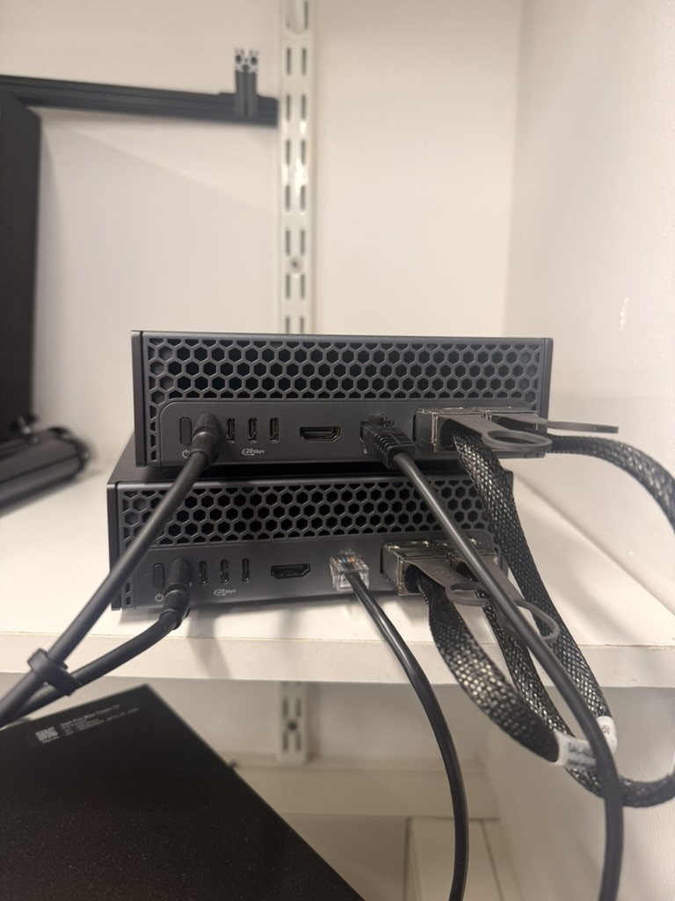

# Local AI for collections data

Three tools for missing information in collections records: countries, article
titles and coordinates. There is also a PlaceBot workflow for processing millions
of locality records on a GB300.

The tools use **NVIDIA Nemotron 3 Super 120B-A12B**, with prompts and checks for
each task. We developed the local workflows on two **Dell Pro Max with GB10**
systems and the larger PlaceBot workflow on a **Dell Pro Max with GB300**.



Photograph: Jack Dan Hollister, [CC BY 4.0](https://creativecommons.org/licenses/by/4.0/).

## Install

With Python 3.11 or newer, from this repository's folder:

```sh
python -m venv .venv
source .venv/bin/activate
python -m pip install .
```

The commands below need your input records and a running local Nemotron service.
The [setup notes](docs/notes.md#run-the-three-gb10-experiments) explain the input
formats and model connection. Each GB10 command defaults to a 24-hour window,
with no record-count cap. It stops earlier if the input runs out, you interrupt
it, or repeated requests fail.

## Missing countries

If a record has an empty country field but names the country in its locality
text, use [run_country.py](scripts/gb10/run_country.py). It finds the country in
the supplied text, keeps the source passage and reviews the proposed value.

```sh
python scripts/gb10/run_country.py --input data/private/country.jsonl --output runs/country
```

## Missing article titles

If a bibliography record is missing its article title, use
[run_bibliography.py](scripts/gb10/run_bibliography.py). It compares the record
with possible matches in your bibliography, checks the publication details and
copies a title from a supported match for review.

```sh
python scripts/gb10/run_bibliography.py --input data/private/bibliography.jsonl --output runs/bibliography
```

## Localities without coordinates

Use [run_locality.py](scripts/gb10/run_locality.py) to georeference locality text
with PlaceBot. It takes the locality and available geographic context, proposes
coordinates and checks the returned fields.

```sh
python scripts/gb10/run_locality.py --input data/private/locality.jsonl --output runs/locality
```

The source records stay unchanged. Answers and checks are saved in the chosen
output folder so you can review them. Add `--plan-only` to any command to check
the input without calling the model. For artificial examples, run
`collections-ai demo`.

## PlaceBot on a GB300

For millions of records, the [GB300 workflow](scripts/gb300/) prepares the source
data, sends shared locality descriptions once and runs 100 requests in parallel.
It saves progress so processing can continue across sessions.

The GB300 run processed **4,183,811 distinct locality inputs representing
9,122,868 specimens**. Across its recorded processing windows, it averaged about
**22,500 requests/hour**. The [saved GB300 summary](results/gb300-summary.json)
records the counts and timing.

Start by preparing the runtime and input. The supplied CSV is an artificial
example; replace it with your own data.

```sh
collections-ai gb300-runtime --output runs/gb300-runtime
collections-ai gb300-source --input examples/gb300_records.csv --output runs/gb300-source
python scripts/gb300/prepare_gb300_combined_experiment.py --source-root runs/gb300-source --output runs/gb300-prepared
```

Then follow the [GB300 setup instructions](docs/notes.md#prepare-and-run-the-gb300-workflow)
to connect the model service, initialize the run and start processing. You can
use a 24-hour window or process the full input with `start --continuous`.

## About

This accompanies *On-Device AI for Data Cleaning, Standardisation, and Exploration
in Collections Management*, by **Jack D. Hollister and Steen Dupont**, Natural
History Museum, London, for TDWG 2026.

Thank you to Dell Technologies and NVIDIA for access to and support for the
computing hardware. Code is MIT licensed; the hardware photograph is CC BY 4.0.
Input formats, settings, references and checks are together in
[the setup notes](docs/notes.md). Museum records, model responses and model
weights are not included.
